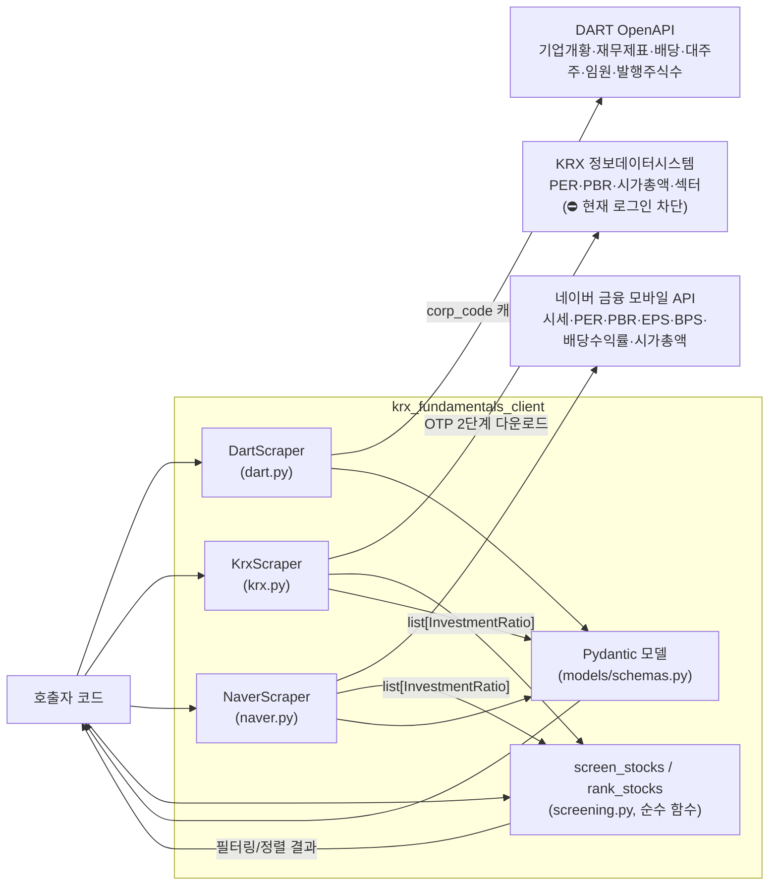

# 사용 가이드

처음이라면 [README](../README.md) 부터.

<!-- toc -->
- [더 쓰기](#더-쓰기)
- [구조](#구조)
- [개발](#개발)
<!-- /toc -->

## 더 쓰기

여러 종목의 재무제표를 한 번에 (DART `fnlttMultiAcnt`, 최대 100종목/호출):

```python
financials = await dart.fetch_financials_batch(["005930", "000660", "035420"], year=2025)
for ticker, fs in financials.items():
    if fs is not None:
        print(ticker, fs.revenue, fs.net_income)
```

키 여러 개를 순환할 때는 `DartQuotaExceededError` 를 잡아 다음 키로 넘어간다:

```python
from krx_fundamentals_client import DartQuotaExceededError, DartScraper

async def fetch_with_rotation(tickers, keys):
    for key in keys:
        scraper = DartScraper(api_key=key)
        try:
            return [await scraper.fetch_company(t) for t in tickers]
        except DartQuotaExceededError:
            continue
        finally:
            await scraper.close()
    raise RuntimeError("모든 키가 일한도를 소진했다")
```

스크리닝·랭킹 — `NaverScraper` 가 채운 PER·PBR 로 그 자리에서 거르고 정렬한다(KRX 벌크 경로는 막혀 있으니 종목을 넘겨 모은다):

```python
from krx_fundamentals_client import NaverScraper, RankingMetric, rank_stocks, screen_stocks

naver = NaverScraper()
try:
    ratios = await naver.fetch_batch(["005930", "000660", "035420", "005380"])
    value_stocks = screen_stocks(ratios, per_max=15.0, pbr_max=1.2)
    top_by_pbr = rank_stocks(ratios, RankingMetric.PBR)
finally:
    await naver.close()
```

## 구조



DART 상세 조회는 모두 `corp_code` 가 필요하다. 첫 호출에서 전체 매핑을 한 번 내려받아 인스턴스에 24시간 캐시하므로, 여러 종목을 볼 때는 스크레이퍼 인스턴스를 재사용한다.

## 개발

```bash
uv sync --extra dev
uv run pytest                        # 테스트 (HTTP 는 pytest-httpx 목)
uv run ruff check src/ tests/        # 린트
```
